  

  
  &nbsp;
  

  SideQuest is an Alliance guild on <b>World of Warcraft: Forever</b>, in the US region on the Normal ruleset.
  We level together, run dungeons, and raid once the guild is ready. The journey and the raid both count.

<h2 align="center">The quest board</h2>

Everything that runs the guild is open source. Pick a notice and take the quest.

  
  
  

<h2 align="center">Take a quest</h2>

| Repo | What it is | Start here |
|---|---|---|
| [website](https://github.com/SideQuest-Guild/website) | The site, its API and the database | `make install`, `make db-up migrate`, `make dev` |
| [bot](https://github.com/SideQuest-Guild/bot) | The Discord bot. It talks to the API and nothing else | `make install`, then `make bot` with the API running |
| [addon](https://github.com/SideQuest-Guild/addon) | The WoW addon and the `sidequest-sync` uploader | `luajit tests/run_tests.lua` |

New here? Read [how to contribute](https://github.com/SideQuest-Guild/.github/blob/main/CONTRIBUTING.md) before your first pull request. Keep changes small, write tests for what you change, and title the pull request as a [Conventional Commit](https://www.conventionalcommits.org) such as `fix: the raid chart keeps its groups after a reload`.

<h2 align="center">Loot: SQL</h2>

  Progression raids use <b>SQL</b>, short for SideQuest Loot and said "<a href="https://www.youtube.com/shorts/z5p-aMyfT98">squeel</a>".
  It is EPGP with a loot council for the biggest drops. You earn EP by showing up, you pay GP when you take gear,
  and your priority is EP divided by GP. <a href="https://sidequest-guild.com/raids/#loot">Read the full rules</a>.

<h2 align="center">Found a security problem?</h2>

  Please don't open an issue. Report it privately from the repo's <b>Security</b> tab with <b>Report a vulnerability</b>.
  The <a href="https://github.com/SideQuest-Guild/.github/blob/main/SECURITY.md">security policy</a> covers what to send and what happens next.

  SideQuest is a player-run guild, not affiliated with or endorsed by Blizzard Entertainment. 
  World of Warcraft is a trademark of Blizzard Entertainment, Inc. The paintings here are original.

